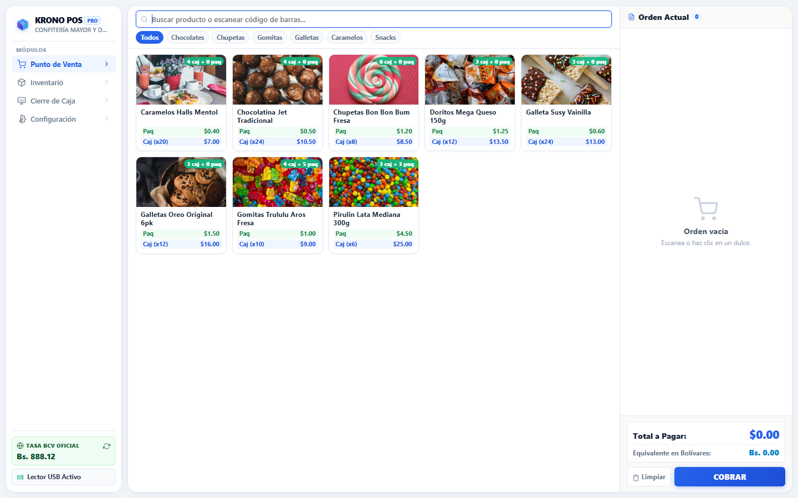
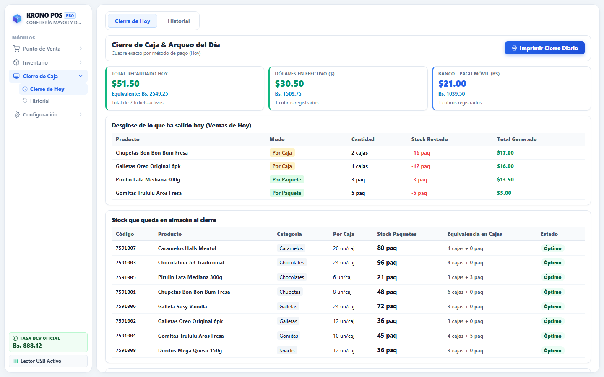
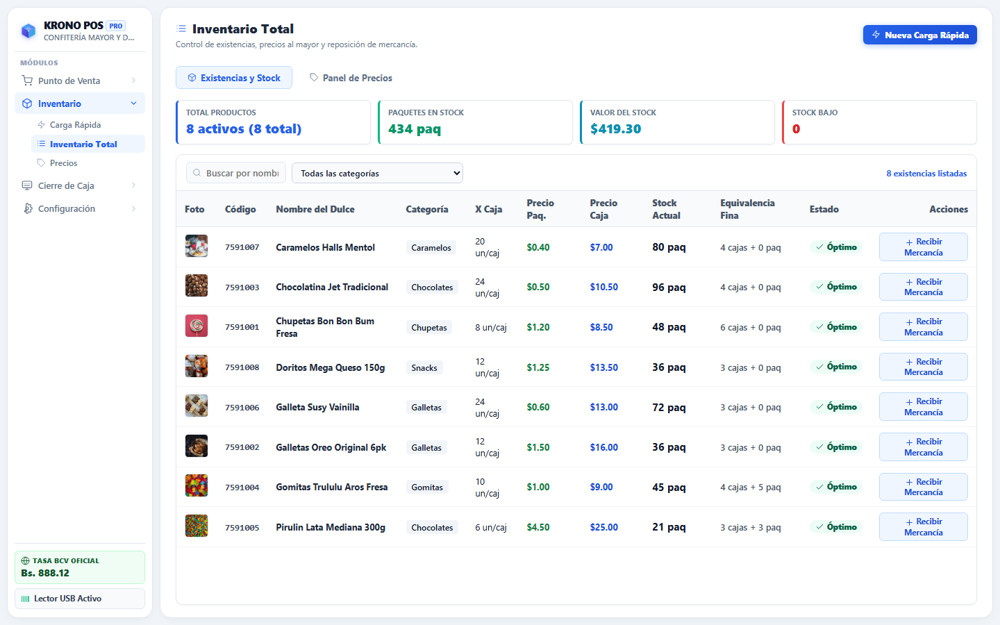
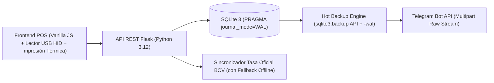

# KRONO POS — Sistema Comercial Offline-First (Mayor y Detal)


**KRONO POS** es un sistema comercial de Punto de Venta (POS), control de inventario dual (**venta por Caja al mayor y por Paquete al detal**) y arqueo de caja bimonetario (**USD / VES**), diseñado desde cero para operar con respuesta instantánea 100% *offline* incluso en hardware comercial limitado (4 GB RAM / Intel Core 2 Duo), con respaldos consistentes en caliente enviados directo a **Telegram**.

---

## Capturas del Sistema en Producción

### Punto de Venta con Lector USB HID & Sincronización BCV


### Cierre de Caja Diario, Arqueo por Método de Pago y Equivalencia de Stock


### Gestión de Inventario Mayorista / Detal


---

## Decisiones de Ingeniería y Arquitectura



1. **Transacciones Atómicas y Control de Concurrencia en Stock Dual:**
   * Un mismo carrito puede contener líneas del mismo producto vendidas simultáneamente por **Caja** (`unidades_por_caja * cantidad`) y por **Paquete**.
   * El motor de cobro acumula el descuento real por SKU antes de confirmar y ejecuta actualizaciones condicionales atómicas (`WHERE id = ? AND stock_paquetes >= ?`) con `ROLLBACK` inmediato ante condiciones de carrera.
2. **Respaldos Consistentes en Caliente (`sqlite3.backup` + Modo WAL):**
   * Copiar un archivo `.db` directamente mientras SQLite opera en modo `WAL` puede omitir transacciones activas en el archivo `-wal` o corromper el respaldo.
   * KRONO POS utiliza la API nativa `origen.backup(destino)` hacia un archivo temporal autónomo (`PRAGMA journal_mode = DELETE`) y construye una petición `multipart/form-data` nativa sin dependencias externas hacia **Telegram Bot API**.
3. **Bimonetarismo Resiliente (USD / Bolívares):**
   * Sincroniza la tasa oficial en tiempo real y almacena la última tasa válida en SQLite para garantizar operación ininterrumpida durante cortes de internet.
4. **Seguridad de Configuración:**
   * Separación estricta entre configuración pública de interfaz (`get_public_config`) y credenciales sensibles (PIN de supervisor para ajustes/anulaciones y tokens de respaldo).

---

## Ejecución Rápida

### Opción 1: Entorno Local (Python 3.10+)
```bash
git clone https://github.com/Jesus-Soto-Noto/krono-pos.git
cd krono-pos
pip install -r requirements.txt
cp .env.example .env
python app.py
```
Abre `http://127.0.0.1:5000` en tu navegador. *(PIN de supervisor por defecto en modo demo: `1234`)*.

### Opción 2: Contenedor Docker
```bash
docker build -t krono-pos .
docker run -p 5000:5000 -e KRONO_SUPERVISOR_PIN=1234 krono-pos
```

---

## Autor

Desarrollado por **Jesús A. Soto Noto** — Desarrollador de Software Full Stack  
[LinkedIn](https://www.linkedin.com/in/jesus-soto-noto) · [GitHub](https://github.com/Jesus-Soto-Noto)
